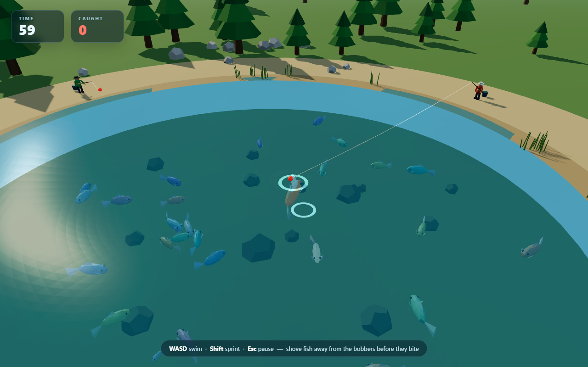
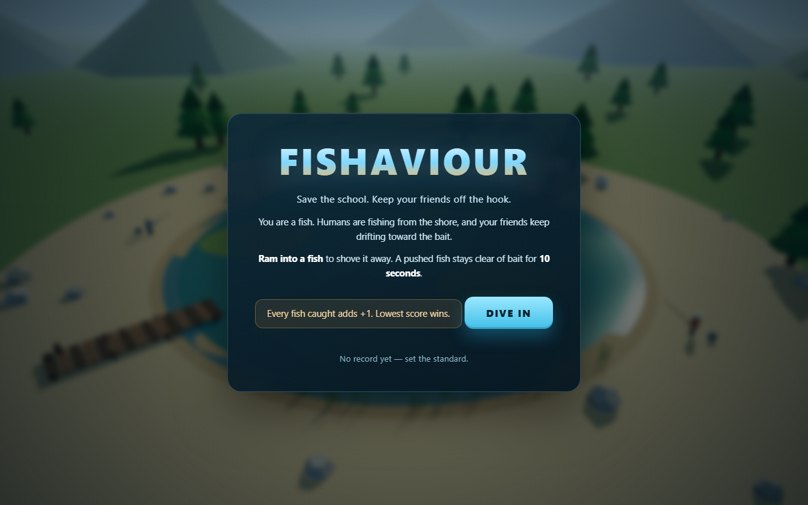

# Fishaviour

**A 3D browser arcade game where you're the fish that saves the school.**

Three anglers. Thirty friends. Sixty seconds. Shove your schoolmates away from the
bait before they get hooked. Every fish caught adds **+1** — the lowest score wins.

### ▶ [Play in your browser](https://blue-phoenix82.github.io/fishaviour/)

No install, no build step, no account. Keyboard required.



## The loop

You are the pale fish in the middle of the lake. Three humans cast from the shore,
and every so often one of their bobbers starts pulling your friends in.

- **Ram a fish** to shove it off the bait. It flashes, gets knocked back, and stays
  spooked for **10 seconds**.
- **One fish per bobber.** A fish heading for bait glows and carries a floating `!`
  marker, so you know exactly who needs saving.
- **Bite window.** When a fish reaches the bobber it starts biting for about
  **1.3 seconds** — the bobber dips and a red ring closes in. Hit it in that window
  and it escapes.
- **Lowest score wins.** Every fish caught costs you a point, and your best (lowest)
  score is remembered in `localStorage`.

## Controls

| Key | Action |
| --- | --- |
| `W A S D` / arrow keys | Swim |
| `Shift` | Sprint |
| `Esc` | Pause / resume |
| `Enter` / `Space` | Start or play again |

## Screenshots

<details>
<summary>Title screen</summary>



</details>

## How it is built

Plain HTML, hand-written ES modules, and a locally vendored copy of **Three.js r160**.
There is no framework, no bundler, no npm install, and no network request at runtime.

- Low-poly lake, shoreline, pines, dock, reeds, rocks, and a custom sky shader.
- Procedural fish with wander, school, bait-claim, bite, and respawn behaviour.
- Three anglers with a cast → wait → bite → reel state machine, rods, lines, and bobbers.
- Synthesised WebAudio sound effects — no audio files.
- Responsive HUD, pause menu, results screen, and local best score.

```
index.html              UI, HUD, menus, all styles, import map
src/main.js             renderer, camera, boot
src/game.js             round loop, scoring, camera, input, HUD wiring
src/world.js            sky, sun, lights, water, shore, trees, dock, props
src/fish.js             low-poly fish, AI, bait claiming, biting, respawn
src/humans.js           humans, rods, lines, bobbers, cast/reel state machine
src/player.js           the player fish and movement
src/audio.js            procedural WebAudio sound effects
vendor/three.module.js  Three.js r160 (MIT)
assets/                 README screenshots
```

## Run locally

ES modules need a web server — opening `index.html` directly with `file://` will not work.

**Windows:** double-click `run.bat`.

**Any platform:**

```bash
python -m http.server 8123 --bind 127.0.0.1
```

Then open <http://127.0.0.1:8123>.

## Tuning knobs

| File | What to tweak |
| --- | --- |
| `src/game.js` | `ROUND_TIME` (60 s), `FISH_COUNT` (30) |
| `src/humans.js` | `LURE_RADIUS` (9), cast/reel timings |
| `src/world.js` | `HUMAN_SPOTS`, lake radius, scenery |
| `src/fish.js` | `BITE_TIME` (1.35 s), `RESPAWN_DELAY` (6 s), swim speeds, 10 s spook timer |
| `src/player.js` | `MAX_SPEED`, `SPRINT_SPEED` |

## Roadmap

- Underwater camera POV with rise/dive, so you can look up from below the surface at
  the anglers and the shore.

## Credits & license

Created by [Blue-Phoenix82](https://github.com/Blue-Phoenix82).

Built with [Three.js](https://threejs.org/) r160 (MIT — see
[`THIRD_PARTY_NOTICES.md`](THIRD_PARTY_NOTICES.md)). All other models, terrain, water,
UI, and sound are generated procedurally in code; there are no external art or audio assets.

Fishaviour is released under the [MIT License](LICENSE).
